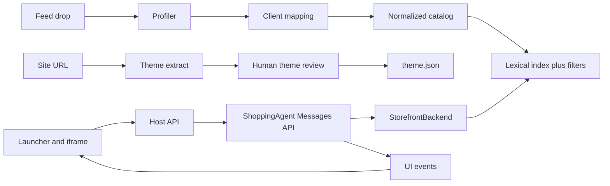

# Architecture

## Ingestion

Postgres holds `product`, `variant`, `category`, `product_category`, `attribute`, and `feed_run`. Tests may use SQLite with the same tables so CI does not need a server. Lexical search is Postgres full text. Filters are predicates on gender, brand, category, price, color, size, and activity. Embeddings are a later table, merged by reciprocal rank, still inside `search_products`. A refresh rebuilds changed product ids only.

Offline enrichment may store a short line taken only from `features` and `description`, with the source field and the feed run id. The model still sees the fenced original. Derived text is not a new fact. Do not generate reviews.

## Tool layer

`clients/rei` implements `StorefrontBackend`. Search and details read the index. Cart methods write a session cart. `get_orders` is not registered because `enable_orders` is off. `search_policies` returns an empty list until a corpus is loaded. `get_fulfillment_options` returns an empty list until a live API exists. `checkout_handoff` returns the client cart URL. The model never sees that URL.

Quarantined columns (`coupon-price`, `MARGIN`, `margin-dollars`, `market_id`, `NavCatID`, `TaxcatID`, `Subprogram`, UUID-named attributes) are dropped before a row is fenced. A unit test loads a fixture row that contains those columns and asserts the tool payload does not.

## Orchestration

One `ShoppingAgent` process per client, so `brand_voice` stays in the cached static prompt. Page context, memory, cart, and the snapshot time go in the dynamic fence. The turn model is the repo default `claude-sonnet-5`. Memory extraction stays on `memory_model`. A separate router model is unnecessary while the five skills still route.

## Grounding and staleness

The price on the card is the enriched record, not the model’s sentence. The widget prints “As of {feed_run.created_at}”. If the snapshot is older than 24 hours, the panel shows a banner. Sale price is shown only when `sale_price` is non-empty and below list. Stock is omitted when `catalog_reports_stock` is false. The domain note forbids a pickup time the fulfillment tool did not return.

## Injection

The existing fence sanitizer stays. Ingest also strips ASCII control characters and lines that look like tool calls before indexing. Evals include a poisoned description. The system prompt already says catalog text is data, not instructions.

## Privacy

Guest sessions do not write memory. A signed-in save requires an explicit ask. Retention default is 90 days, then delete. That is a product default, not a legal conclusion. The widget has a “What you’ve saved” view that uses the host’s read and delete routes. Logs stay at the INFO line described in [docs/safety.md](../safety.md). Do not log tool bodies. The feed directory is gitignored and is not uploaded.

## Cost and latency

Prices from [Anthropic’s pricing page](https://platform.claude.com/docs/en/about-claude/pricing), fetched 2026-10-15: Claude Sonnet 5 is $2 per million input tokens, $10 per million output tokens, $0.20 per million cache-read tokens, and $2.50 per million for a five-minute cache write.

Assumption for a six-turn shop: an 8k-token cached prefix, about three tool rounds on two of the turns and one round on the others, about 3k new input tokens per round, and about 400 output tokens per turn. Order-of-magnitude estimate: about $0.15 to $0.40 when the prefix caches, and above $1 when every turn misses the cache. This is an estimate, not a measurement.

Latency targets, also estimates: first streamed token under 2 seconds, a one-search turn under 8 seconds, a kit under 20 seconds. The config already has `eager_tool_dispatch`, `rolling_conversation_cache`, and `close_on_presentation`.

## Checkout

Handoff. The blueprint has no charge API. OpenAI’s 2026 merchant docs moved the same way. An agent-completed checkout would put card data, tax, membership price, and pickup promises in this process. PCI scope and liability stay with the client. Until the client sends a URL contract, the button opens the site and does not pass payment. `https://www.rei.com/checkout` is not verified.

## Scale and tenancy

Ten times this catalog is about 1.3 million products and about 13 million SKUs. The row count still fits one Postgres. The variant cap is the constraint: split families over 60 SKUs by color. Many clients means many agent processes sharing the ingest library. Do not swap `brand_voice` inside one cached prompt.

## Deployment

The host is a new service beside the examples, not a rewrite of `examples/retail`. The prototype uses the Messages API and `ANTHROPIC_API_KEY`. [docs/deployment.md](../deployment.md) is the path to Vertex, Bedrock, or Foundry later.

Packages to add, without replacing the examples: `ingest/` for the loader and profiler, `clients/rei/` for the mapping, theme, and backend, and `widget/` for the Next.js embed. Update `CLAUDE.md` when those packages exist.
